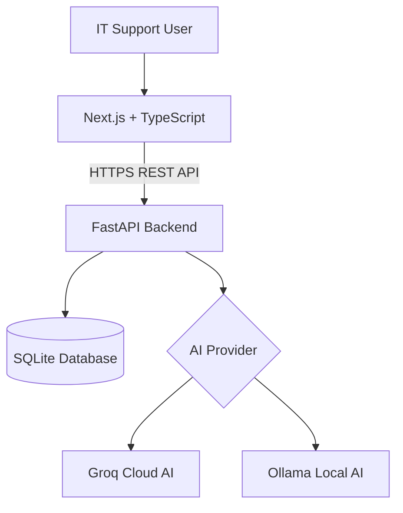

# 🧠 ITOps AI

<div align="center">

### Intelligent IT Operations Platform

**Resolve smarter. Troubleshoot faster. Document better.**

An AI-powered full-stack platform for IT incident management, intelligent troubleshooting, and professional ServiceNow ticket drafting.

[](https://itops-ai.vercel.app)
[](https://github.com/MashuduRamoba/itops-ai)


</div>

---

## ✨ Overview

**ITOps AI** helps IT support professionals turn unstructured incident descriptions into actionable troubleshooting guidance.

Instead of manually researching every issue and writing ticket updates from scratch, users can generate structured incident analysis and documentation using cloud-hosted AI.

Designed around real-world enterprise IT support workflows, with a focus on Microsoft 365, SharePoint Online, Microsoft Entra ID, and ServiceNow.

## ⚡ Core Features

| 🧠 AI Incident Analysis | 🎫 Incident Management |
|---|---|
| Generate issue summaries, possible root causes, troubleshooting steps, and escalation recommendations. | Create, categorise, prioritise, update, and track IT incidents. |

| 📝 ServiceNow Drafts | ☁️ Flexible AI Providers |
|---|---|
| Produce professional ticket updates that support consistent incident documentation. | Use Groq Cloud AI in production or Ollama for local development. |

## 🖥️ Application Preview

> Screenshots of the live dashboard, AI Analysis, and Incident Management interfaces will be added here.

**[Launch the live application →](https://itops-ai.vercel.app)**

## 🏗️ System Architecture



**Deployment architecture**

- **Vercel** — Hosts the Next.js frontend.
- **Render** — Hosts the Python FastAPI backend.
- **Groq** — Provides cloud AI inference.
- **SQLite** — Stores incident records and saved analysis.

## 🛠️ Technology Stack

| Layer | Technology |
|---|---|
| Frontend | Next.js, React, TypeScript |
| Backend | Python, FastAPI |
| AI Inference | Groq API, Ollama |
| Database | SQLite |
| Deployment | Vercel, Render |
| Version Control | Git, GitHub |

## 📂 Project Structure

```text
itops-ai/
├── backend/
│   ├── agent.py
│   ├── main.py
│   ├── database.py
│   └── requirements.txt
├── frontend/
│   ├── src/
│   │   ├── app/
│   │   └── lib/
│   └── package.json
├── .github/
│   └── workflows/
├── .gitignore
└── README.md
```

## 🚀 Getting Started

### 1. Clone the repository

```bash
git clone https://github.com/MashuduRamoba/itops-ai.git
cd itops-ai
```

### 2. Configure the backend

```bash
cd backend
python -m venv .venv
```

Activate the virtual environment on Windows:

```powershell
.\.venv\Scripts\Activate.ps1
```

Install dependencies:

```bash
pip install -r requirements.txt
```

### 3. Configure AI

Create a `backend/.env` file.

**Groq Cloud AI**

```env
AI_PROVIDER=groq
GROQ_API_KEY=your_api_key_here
GROQ_MODEL=openai/gpt-oss-20b
```

**Or use Ollama locally**

```env
AI_PROVIDER=ollama
OLLAMA_BASE_URL=http://127.0.0.1:11434
OLLAMA_MODEL=llama3.2:3b
```

For Ollama, install Ollama and pull the model:

```bash
ollama pull llama3.2:3b
```

Never commit API keys or `.env` files.

### 4. Run the backend

```bash
python -m uvicorn main:app --reload
```

API documentation: `http://127.0.0.1:8000/docs`

### 5. Run the frontend

Open a second terminal:

```bash
cd frontend
npm install
```

Create `frontend/.env.local`:

```env
NEXT_PUBLIC_API_URL=http://127.0.0.1:8000
```

Start the application:

```bash
npm run dev
```

Open `http://localhost:3000`.

## 🔌 REST API

| Method | Endpoint | Description |
|---|---|---|
| GET | `/health` | Backend status and AI configuration |
| GET | `/api/incidents` | List incidents |
| POST | `/api/incidents` | Create incident |
| GET | `/api/incidents/{id}` | View incident |
| PATCH | `/api/incidents/{id}` | Update incident |
| POST | `/api/analyse` | Generate AI analysis |
| POST | `/api/incidents/{id}/analyse` | Analyse a saved incident |

## 🗺️ Roadmap

- [x] Full-stack frontend and backend
- [x] Incident creation and tracking
- [x] AI-assisted troubleshooting
- [x] Groq Cloud AI integration
- [x] Ollama local AI support
- [x] Vercel and Render deployment
- [ ] Enhanced structured AI analysis interface
- [ ] PostgreSQL persistent storage
- [ ] User authentication and role-based access
- [ ] ServiceNow API integration
- [ ] Microsoft 365 knowledge base
- [ ] Incident analytics dashboard

## 🔐 Security and Responsible AI

ITOps AI is a portfolio and development project, not a production-ready enterprise support system.

AI-generated recommendations require human review. The application does not independently perform administrative actions or resolve incidents.

Do not submit confidential company information, passwords, MFA codes, or sensitive personal data to the public demo. Production-grade authentication and durable database storage are future improvements.

## 👨‍💻 Developer

**Mashudu Ramoba**

Software Development • Cloud Computing • IT Automation • Microsoft 365

Building practical solutions at the intersection of enterprise IT operations, cloud infrastructure, and artificial intelligence.

---

<div align="center">

### ⭐ ITOps AI

**Making IT support smarter, one incident at a time.**

[Live Application](https://itops-ai.vercel.app) · [Source Code](https://github.com/MashuduRamoba/itops-ai)

</div>
